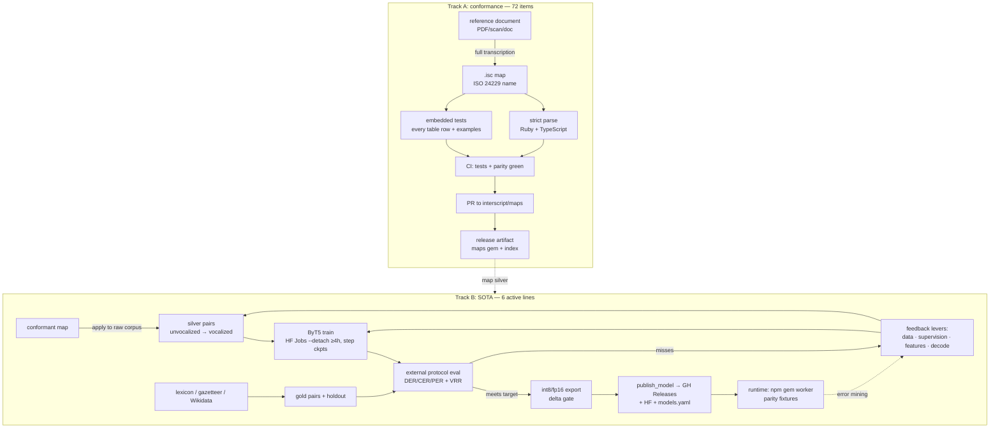

# WO89 — Master list: every unencoded system, model requirement, and the graph path to SOTA

Status: PLAN (2026-10-28) — supersedes ad-hoc inventory; work orders created per batch
Goal: encode every remaining reference table in the reference collection; drive all six
Track B model lines to their SOTA targets; no system left unencoded or model-blocked
without an owner decision recorded.

## Classification legend

- **D** — deterministic: the source table fully specifies the output; one `.isc` map
  achieves conformance. No model involved.
- **D+M** — map is deterministic, but real-world text carries less information than
  the table assumes (unwritten vowels, polyphones, unvocalized abjad). Ship the map
  now; a model companion is the recorded follow-up for unvocalized input.
- **M** — output is not a character-wise function of the input (lexical readings,
  unvocalized scripts as the primary input form). Requires a model.
- **X** — blocked: no Unicode-representable source encoding, no obtainable source
  document, or an owner decision is the gate. Only partial sub-items exist today
  (the two raster columns inside BGN/PCGN Inuktitut, documented in PR #214).

Two tracks, never conflated:
- **Track A (conformance):** transcribe the authority's table; the map is the artifact;
  CI gates = strict parse + embedded tests + cross-runtime parity.
- **Track B (SOTA):** the conversion of natural, imperfectly written text; the model
  is the artifact; CI gates = external-protocol metrics + quantization delta + release.

## A. Track A inventory — 72 remaining items

### A1. BGN/PCGN — 15 systems + 1 revision (all D except noted)

Reference collection: 55 PDFs; 40 systems encoded (56 maps). Inuktitut closed in PR #214.

| # | System | lang | Class | Notes / work order |
|---|--------|------|-------|--------------------|
| 1 | Adyghe | ady | D | Cyrillic table; WO90 batch 1 |
| 2 | Avar | ava | D | Cyrillic table; WO90 batch 1 |
| 3 | Chuvash | chv | D | Cyrillic table; WO90 batch 1 |
| 4 | Kabardian | kbd | D | Cyrillic table; WO90 batch 1 |
| 5 | Karachay-Balkar | krc | D | Cyrillic table; WO90 batch 1 |
| 6 | Ossetian | oss | D | Cyrillic table; WO90 batch 1 |
| 7 | Udmurt | udm | D | Cyrillic table; WO90 batch 1 |
| 8 | Yakut | sah | D | Cyrillic table; WO90 batch 1 |
| 9 | Kurdish 2012 revision | kur | D | diff against odni-kur-Arab-Latn-2007/2011; WO90 batch 1 |
| 10 | Hebrew | heb | D+M | table is deterministic on pointed text; unvocalized input → existing [[heb-vocalized-plane]] lineage is the companion |
| 11 | Modern Syriac | aii/syc | D+M | pointed table D; primary real-world input is unvocalized → M companion later; resolve syc vs syr/aii codes at encoding |
| 12 | Burmese | mya | D | table deterministic on written form (stacked consonants are explicit); real-world D+M follow-up |
| 13 | Dzongkha | dzo | D | orthographic transliteration table |
| 14 | Lao | lao | D | table deterministic; polyphone disambiguation is a D+M follow-up |
| 15 | Shan | shn | D | table deterministic |
| 16 | Khmer | khm | D+M | table deterministic on written form; subnational vowel/polyphony → existing khm model line is the companion |

### A2. ALA-LC — 47 catalog gaps (official catalog: 78 tables; 30 encoded)

Class on the table itself; D+M noted where unvocalized/unsegmented input is the norm.

| # | System | Class | # | System | Class |
|---|--------|-------|---|--------|-------|
| 1 | Armenian (hye/arm) | D | 25 | Malay (Jawi-Arabic) | D+M |
| 2 | Balinese | D | 26 | Manchu | D |
| 3 | Batak | D | 27 | Mandekan (N'ko) | D |
| 4 | Burmese | D | 28 | Manipuri (Meitei) | D |
| 5 | Cham | D | 29 | Moplah | D+M |
| 6 | Cherokee | D | 30 | Moroccan Tamazight | D |
| 7 | Chinese (Wade-Giles) | D | 31 | Non-Slavic Cyrillic | D |
| 8 | Church Slavic | D | 32 | Ottoman Turkish | D+M |
| 9 | Coptic | D | 33 | Pushto | D+M |
| 10 | Deseret | D | 34 | Romanian (Cyrillic) | D |
| 11 | Hebrew and Yiddish | D+M | 35 | Rusyn | D |
| 12 | Inuktitut | D | 36 | Santali (Ol) | D |
| 13 | Japanese (McCune-Reischauer) | D (kana) / M (kanji readings) | 37 | Shan | D |
| 14 | Javanese/Sundanese/Madurese | D | 38 | Sindhi | D |
| 15 | Jawi-Pegon | D | 39 | Syriac | D+M |
| 16 | Judeo-Arabic | D+M | 40 | Tamashek | D |
| 17 | Kashmiri | D | 41 | Thai | D |
| 18 | Kazakh (Arabic script) | D+M | 42 | Tibetan | D |
| 19 | Khmer | D | 43 | Tod-Oirat-Old Kalmyk | D |
| 20 | Kurdish | D | 44 | Uighur | D+M |
| 21 | Ladino | D | 45 | Urdu | D+M |
| 22 | Lao | D | 46 | Uzbek | D |
| 23 | Lepcha | D | 47 | Vai | D |
| 24 | Limbu | D | | | |

### A3. DIN — 5 documents (all D)

Reference collection: 8 DIN PDFs; 3 encoded (32707, 33903, 33904).

| Doc | Class | Notes |
|-----|-------|-------|
| DIN 1460-2 | D | subject confirmed against the document at encoding |
| DIN 31635 | D | Arabic |
| DIN 31636 | D | subject confirmed at encoding |
| DIN 32706 | D | subject confirmed at encoding |
| DIN 32708 | D | subject confirmed at encoding |

### A4. BSI — 2 documents (all D)

| Doc | Class | Notes |
|-----|-------|-------|
| BS 2979:1958 | D | subject confirmed at encoding |
| PD 6505:1982 | D | subject confirmed at encoding |

### A5. ICS 630-01 — Annex D Chinese (D)

29 documents in the reference collection; Annexes encoded through WO-series
(Annex G = PR #213). Annex D (Chinese personal names, pinyin) remains.

### A6. ISO scope gaps (all D tables; scope, not new authorities)

| Gap | Class | Notes |
|-----|-------|-------|
| ISO 9 non-Russian Cyrillic coverage | D | verify per-letter coverage of the 1995 table vs corpus |
| ISO 259 Hebrew | D | letter mapping; unvocalized input is Track B |
| ISO 7098 Chinese (pinyin) | D | large per-character table |
| ISO 9985 Armenian | D | |
| ISO 15919 Indic remainder | D | enumerate the script set vs corpus; encode the missing scripts |

### A7. Source-acquisition diffs

| Item | Class |
|------|-------|
| ICAO systems: obtain current source docs, diff vs corpus | D |
| UNGEGN systems: obtain source docs, diff vs corpus | D |

**Track A totals: 72 items — 63 D, 8 D+M, 1 M-part (Japanese kanji). Zero X.
Every remaining table is encodable as a deterministic map.**

## B. Track B matrix — model lines vs SOTA targets

| Line | Model / metric | Current | Target | WO | Levers (graph edges) |
|------|----------------|---------|--------|----|----------------------|
| Hebrew vocalization | heb-vocalized-plane-2.0 DER | 8.18 | **DER < 5** (int8 < 6) | 63 | data: additional labeled corpora (Dicta machine labels precedent); plane-conditioning scale; decode policy |
| Arabic vocalization | ara-vocalized-2.0 DER / WikiNews | 2.2864 / 11.83 | **DER < 2.0 / WER < 8** | 64 | r6-morph knowledge injection on v2 lineage; news-domain data; oracle-target quality (r8 noisy-student NEGATIVE — do not retry) |
| Persian registers | fas-phonemic-1.0 CER | 1.6 | **CER < 0.7 all registers** | 66 | register-balanced corpora; G2P lineage (tha-g2p template) |
| Thai phonemic | tha v6a PER (clean split) | 19.29 | **PER < 2** | 67 | lexicon (v6a shipped-candidate line; curriculum NEGATIVE), schedule-matched controls, tha-small 2.85 lineage as student template |
| Khmer Latin | khm-latn-1.0 CER / dict arm | 27.42 / 15.02 (dict-internal) | **CER < 15 + hit-rate** | 68 | lineage recovery (secryst corpus re-derivation, now concrete); owner-gated SEAlang / full Chuon Nath IPA |
| Urdu diac | urd-diac CER | 3.57 | **CER < 3** | 65 | decorrelated teachers only; VRR |
| Urdu G2P | urd-ipa-1.0 CER | 14.77 | license gate green | 65 | BLOCKED-OWNER: commercial-license data selection (option drafts in WO50) |

Standing negatives — never retry as written: RL distillation, LLM-teacher labels,
noisy-student relabel on correlated teachers, curriculum on full mixes, beam decode
on flat byte students, direct-division Sinkhorn.

## C. Graph path — reference to SOTA

Dependency edges that matter:

1. Track A maps are the silver-data generators for every Track B line with a
   deterministic surface (Hebrew map ↔ vocalization pairs; Urdu ALA-LC ↔ diac pairs;
   Khmer BGN/PCGN ↔ latn pairs). Encoding a map feeds its model line.
2. Lexicons gate three targets: Thai (PER < 2 runs through lexicon + schedule controls),
   Khmer (open phoneme supply exhausted at ~3.3k gold pairs), Persian (registers).
3. Owner decisions gate two: Urdu G2P license; Khmer SEAlang/Chuon-Nath licensing.
4. The Thai PER < 2 target additionally needs the length-prior mechanism solved
   (v6b curriculum NEGATIVE) — filtered fine-tune or compound downweighting.

## D. Execution order

- **P0 — deterministic batches, unblocked now (Track A):**
  1. WO90: 8 BGN/PCGN Cyrillic systems + Kurdish 2012 revision (9 maps).
  2. WO91: DIN 5 + BSI 2 + ICS Annex D (8 maps).
  3. WO92: ALA-LC batches — alphabets/syllabaries first (Cherokee, Deseret, Vai,
     N'ko, Ol, Meitei, Lepcha, Limbu, …), Arabic-script tables next, Chinese/Japanese last.
  4. WO93: ISO scope gaps + ICAO/UNGEGN acquisition diffs.
  5. Housekeeping: merge PRs #211–#214 (owner authorization); migrate #166/#167
     `.imp` → `.isc`; TS/Python strict-parse port; PyPI trusted publisher.
- **P1 — D+M companions:** after each map ships, open the model-companion work
  order only for lines with an existing Track B lineage (heb, aii, khm, urd, ottoman/jawi
  as future lines).
- **P2 — Track B pushes (parallel with P0):**
  - B1 Hebrew → data lever first (63).
  - B3 Arabic → r6-morph injection on v2 + news data (64).
  - B4 Urdu diac → decorrelated teacher arms (65).
  - B5 Persian → register-balanced corpora (66).
  - B6 Thai → schedule-matched controls + lexicon filtering (67).
  - B7 Khmer → lineage recovery then owner licensing decision (68).
- **P3 — owner-gated:** Urdu G2P license; Khmer licensing; any new minor version.

## Acceptance

- Every row of section A has a merged PR or a recorded blocker with owner decision.
- Every row of section B is at or past its target with external-protocol numbers,
  quantization delta green, and runtime parity fixtures shipped.
- No negative lever retried as written; every miss recorded in its WO.
